<!-- Les visuels de profile/ui/ sont générés : node tools/build-profile.mjs -->

<a href="https://corgidev42.github.io/"></a>

  &nbsp;
  &nbsp;
  &nbsp;
  <a href="https://github.com/42-eve">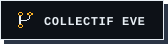</a>

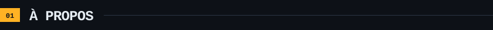

Développeur formé à l'**[École 42](https://42.fr/)** (campus de Perpignan), j'ai appris à coder en construisant : un shell, un serveur IRC, un moteur de raycasting, une plateforme d'échecs temps réel. Pas de cours magistraux — des projets, des revues par les pairs et des normes strictes.

Mon terrain de jeu préféré est le **bas niveau** : gestion mémoire, sockets, threads, protocoles. C'est ce que j'ai mis en pratique en **C++17 et Qt 6 / QML sur Linux embarqué**, de l'architecture logicielle jusqu'à l'intégration matérielle.

Je reste **polyvalent** — React et TypeScript côté interface, Django, FastAPI ou Python côté service, Docker pour que tout tourne partout — et j'assume un **workflow assisté par IA** (Cursor, LLM) : un pair pour explorer, tester et documenter plus vite ; l'architecture, la relecture et la validation restent les miennes.

**Je recherche un CDI à Montpellier.** Tout le détail est sur mon portfolio : **[corgidev42.github.io](https://corgidev42.github.io/)**

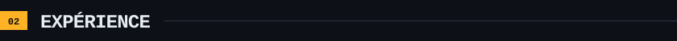

**Développeur systèmes &amp; applicatif — GameSide** · stage de 6 mois · 2026 · Perpignan / télétravail Montpellier

`C++17` `Qt 6 / QML` `Linux embarqué` `Raspberry Pi 4` `REST / JSON` `UDP / TCP` `QTest`

- **Borne photo interactive** — application Qt 6 / QML + C++17 conçue de bout en bout : machine à états du parcours joueur (badge RFID), intégration d'API REST, composition d'images 1920×1080 via QPainter, spool asynchrone tolérant aux pannes réseau, consentement RGPD.
- **Contrôleur de salles LED &amp; arcade** — reverse engineering de protocoles matériels propriétaires (UDP), réécriture en C++ / Qt 6, couche d'abstraction matérielle pour matrices LED et capteurs de sol (15×40 dalles).
- **Cible embarquée** — optimisation de jeux Qt / QML sous contrainte CPU / GPU, scripts de déploiement et documentation d'architecture (ADR / ICD).

> Code propriétaire : seules l'architecture et les technologies sont présentées ici.

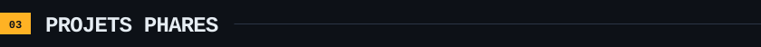

  <a href="https://github.com/KuroeProg/Meditation_Transcendentale">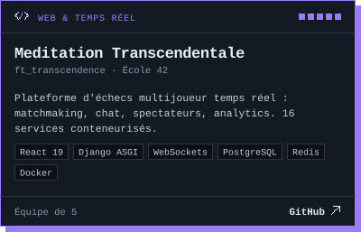</a>
  <a href="https://github.com/Corgidev42/42_ft_irc">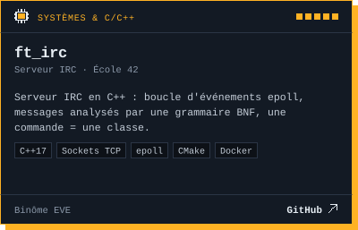</a>
  <a href="https://github.com/Corgidev42/42_minishell">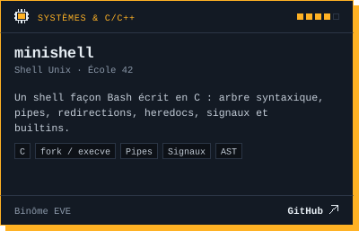</a>
  <a href="https://github.com/EvenZeppa/cub3D">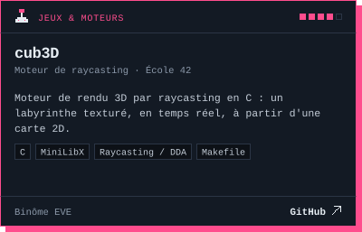</a>
  <a href="https://github.com/Corgidev42/TopQuizz">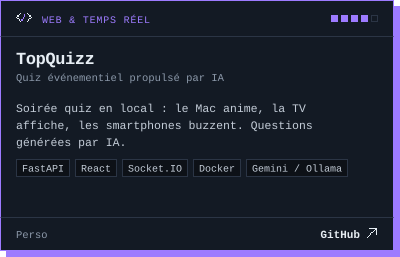</a>
  <a href="https://github.com/Corgidev42/Inception">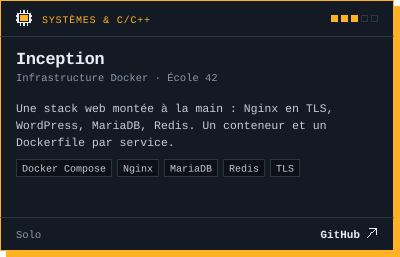</a>

Aussi sur GitHub : [GitAr](https://github.com/Corgidev42/GitAr) (LMS guitare, Next.js) · [PharmAI](https://github.com/Corgidev42/PharmAI) (jeu de révision, React) · [Mnemos](https://github.com/Corgidev42/Mnemos) (app de bureau, Python) · [Snake Together](https://github.com/42-eve/Snake) (C / SDL2) · [philosophers](https://github.com/Corgidev42/42_philosophers) (threads POSIX) · [Smart Calendar](https://github.com/Corgidev42/smart-calendar-gemini) (extension Raycast).

Certains dépôts d'équipe sont hébergés sur le compte d'un coéquipier ; j'y contribue comme sur les autres livrables 42. Les 17 projets sont détaillés sur le <a href="https://corgidev42.github.io/#projets">portfolio</a>.

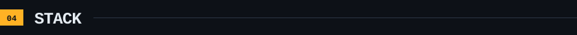

  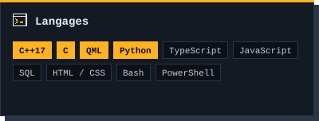
  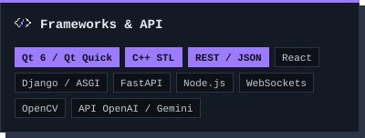
  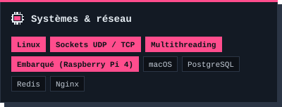
  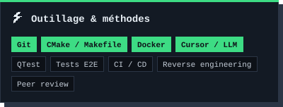

Étiquette pleine = utilisé au quotidien en entreprise ou sur les projets majeurs.

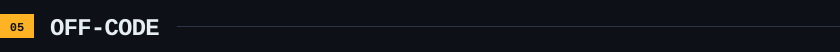

  
  
  
  

 **EVE — Extension of Virtual Exploration** : le collectif monté avec [Even Zeppa](https://github.com/EvenZeppa) à 42 Perpignan. Projets communs, binômes et expérimentation sans barrières → [github.com/42-eve](https://github.com/42-eve)

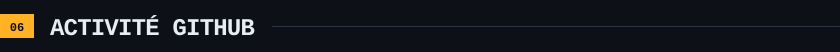

  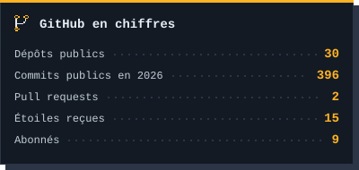
  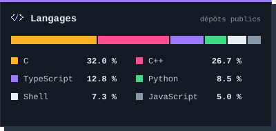

  <picture>
    <source media="(prefers-color-scheme: dark)" srcset="https://raw.githubusercontent.com/Corgidev42/Corgidev42/output/github-contribution-grid-snake-dark.svg">
    
  </picture>

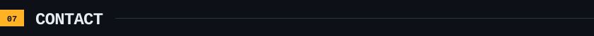

<table>
  <tr><td><b>Portfolio</b></td><td><a href="https://corgidev42.github.io/">corgidev42.github.io</a></td></tr>
  <tr><td><b>E-mail</b></td><td><a href="mailto:vbonnard.dev@gmail.com">vbonnard.dev@gmail.com</a></td></tr>
  <tr><td><b>LinkedIn</b></td><td><a href="https://www.linkedin.com/in/vincent-bonnard-42dev">in/vincent-bonnard-42dev</a></td></tr>
  <tr><td><b>Localisation</b></td><td>Montpellier · Permis B, véhiculé</td></tr>
</table>

  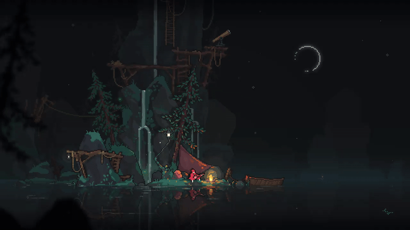 
  <em>« On apprend vite ce qu'on construit lentement. »</em>

